 

[**Website**](https://franciscoliveira.com) &nbsp;·&nbsp; [**Sinformania**](https://sinformania.pt) &nbsp;·&nbsp; [**n.inf**](https://github.com/ninf-fct) &nbsp;·&nbsp; [**Voult**](https://github.com/fmgoliveira/voult)

### About

- 🎓 CS student at **NOVA FCT**, and VP of **n.inf**, the Computer Science student group
- 🏢 Running **[Sinformania](https://sinformania.pt)**, a Portuguese tech & consulting company
- 🏟️ Building **Velo**, a multi-tenant SaaS platform for sports clubs
- 🔐 Into self-hosting: password managers, MCP servers, URL shorteners
- 🎼 I also compose music

### Featured projects

<table>
  <tr>
    <td width="50%" valign="top">
      <h4><a href="https://github.com/fmgoliveira/voult">Voult</a></h4>
      Self-hosted, zero-knowledge password manager (Argon2id + AES-256-GCM) with browser extension and Android app clients.  
      <code>TypeScript</code> · <code>Expo</code> · <code>PocketBase</code>
    </td>
    <td width="50%" valign="top">
      <h4><a href="https://github.com/fmgoliveira/mcp-server">mcp-server</a></h4>
      Self-hosted MCP server that lets Claude work across several Google, Microsoft 365, Canva, GitHub and other accounts at once, with an admin UI.  
      <code>TypeScript</code> · <code>MCP</code>
    </td>
  </tr>
  <tr>
    <td width="50%" valign="top">
      <h4>Velo</h4>
      Multi-tenant SaaS platform for sports clubs, with payments through Stripe Connect. <i>(private)</i>  
      <code>Next.js</code> · <code>Drizzle</code> · <code>PostgreSQL</code> · <code>Stripe</code>
    </td>
    <td width="50%" valign="top">
      <h4><a href="https://github.com/fmgoliveira/fct-vpn-linux">fct-vpn-linux</a></h4>
      A guide to using NOVA FCT's VPN on Linux with <code>snx-rs</code>, including the new 2FA flow.  
      <code>Guide</code> · <code>Linux</code> · <code>VPN</code>
    </td>
  </tr>
</table>

### Tech stack

### Activity

  The activity card is generated by <a href="./scripts/generate_activity.py">a small script</a> that a GitHub Action re-runs every day.

